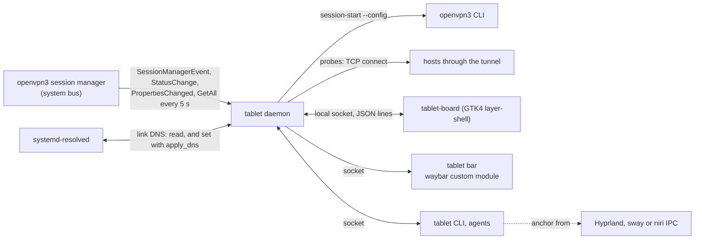

# Tablet design

Tablet is a VPN lamp for a Wayland bar, around openvpn3-linux. The bar shows
one lamp for every profile; right-clicking it opens a drawer with each
profile's state, its checks, openvpn3's health and what happened. This
document is the reference for how it works and why. The README is the tour;
this is the spec.

## Goals

1. **A lamp that tells the truth.** Frost only while a tunnel is connected
   and its checks pass. Anything else says what it is.
2. **Catch the tunnel that looks fine.** openvpn3 can report connected for a
   session the server stopped answering. Probes and openvpn3's own counters
   catch it: that is **stale**.
3. **Catch openvpn3 itself breaking.** A library update can leave a
   source-built openvpn3 unable to start a tunnel. Tablet says so before the
   click that would fail.
4. **Agents ask, people decide.** An agent can find out whether a host needs
   the VPN and ask for it; only a person connects.
5. **Cheap.** Signals when openvpn3 sends them, one property read every few
   seconds while a session exists, nothing while none does.

## Non-goals

- **Not a VPN client.** Tablet never speaks the protocol. openvpn3 starts,
  authenticates and runs every tunnel; Tablet starts and ends sessions and
  reads them.
- **Not a privacy VPN switcher.** One lamp for the tunnels you need for work.
- **No credentials.** Web sign-in happens in the browser openvpn3 opens;
  Tablet only opens the same page again on request. Profiles that need a
  password use openvpn3's own prompt.

## Architecture



| Crate | Role |
|---|---|
| [`bar-anchor`](https://github.com/NathanielInman/bar-anchor) | Anchoring and panel placement, shared by the waybar apps and pinned by tag in the root `Cargo.toml`. |
| `tablet-core` | The model, openvpn3's statuses and sessions (`openvpn.rs`), the checks (`checks.rs`), the doctor (`doctor.rs`), routing names to profiles (`route.rs`), the daemon's state (`state.rs`: events in, effects out), the bar line, config, the socket protocol and the waybar reader. No D-Bus, no UI. |
| `tablet` | The `tablet` binary: daemon, CLI and waybar module. Owns the zbus connection, the threads and the sockets, runs `session-start`, the probes and the doctor, and carries out the model's effects. |
| `tablet-board` | The Linux drawer: GTK4 on `gtk4-layer-shell`, overlay layer, namespace `tablet`, keyboard exclusive while open. |

## Paths

| What | Where | Override |
|---|---|---|
| Config | `~/.config/tablet/config.toml` | `TABLET_CONFIG_DIR` |
| User stylesheet | `~/.config/tablet/style.css` | `TABLET_CONFIG_DIR` |
| History | `$XDG_STATE_HOME/tablet/history.jsonl` (0600, trimmed to 500 lines at start) | `TABLET_STATE_DIR` |
| Logs | `$XDG_STATE_HOME/tablet/daemon.log`, `board.log` (over 1 MB, moved to `.1` when next opened) | `TABLET_STATE_DIR` |
| Socket | `$XDG_RUNTIME_DIR/tablet/tablet.sock` | `TABLET_RUNTIME_DIR` |
| Daemon lock | `$XDG_RUNTIME_DIR/tablet/daemon.lock` | `TABLET_RUNTIME_DIR` |

The runtime directory is mode 0700 and the socket 0600. The daemon holds an
`flock` on the lock file for its lifetime; a second `tablet daemon` exits
with status 75, which `packaging/systemd/tablet.service` treats as success
and does not restart.

## openvpn3

openvpn3-linux's session manager owns `net.openvpn.v3.sessions` on the
system bus (`DBUS_SYSTEM_BUS_ADDRESS` moves it, which the end-to-end test
uses). Every session is an object under `/net/openvpn/v3/sessions/`.

Read:

- `FetchAvailableSessions` on the manager lists the sessions this user may
  see; `GetAll` on each reads `config_name` (the `.ovpn` path given to
  `session-start --config`, or an imported config's name), `session_name`
  (the server), `device_name`, `session_created`, `status` (`(uus)`:
  major, minor, message), `connected_to`, `statistics` (`a{sx}`) and
  `backend_pid`.
- Signals: `SessionManagerEvent` (created, destroyed) on the manager,
  `StatusChange` and `AttentionRequired` on a session, `PropertiesChanged`,
  and `NameOwnerChanged` for the manager's name. A signal about a session
  makes the daemon read that session whole on a helper thread.
- openvpn3 does not promise to send every listener every status change, so
  while any session exists (or a start is running) the daemon reads every
  session every 5 seconds. With no session nothing is read.
- The daemon never calls the manager while nobody owns its name: the bus
  would start it. It starts with the first `session-start`.

A path is never reused, so a session that a scan no longer lists is buried:
a read of it that started before it went (a signal's helper thread) is
ignored when it comes back late.

Act:

- **Connect**: `<openvpn3.command> session-start --config <ovpn>`, stdin
  closed, its output read line by line into the daemon log (any URL in a
  line replaced by `<sign-in page>`), stopped after
  `openvpn3.start_timeout` seconds. openvpn3 opens the web sign-in page
  itself. The CLI exits once the session runs in the background; a
  non-zero exit with no session to show for it fails the profile with the
  CLI's last line ("New tunnel did not respond").
- **Disconnect**: the session's `Disconnect` method.
- **Reconnect**: `Disconnect` on every session the profile has, 600 ms,
  then a new `session-start`. The sessions that existed when the connect
  began are remembered, and none of them can be taken for the new one.

Status codes are openvpn3's `StatusMinor`:

| Minor | Kind |
|---|---|
| `CONN_CONNECTED` | connected |
| `SESS_AUTH_URL`, `SESS_AUTH_USERPASS`, `SESS_AUTH_CHALLENGE`, `CFG_REQUIRE_USER`, `PKCS11_*` | sign-in |
| `CONN_RECONNECTING`, `CONN_RESUMING` | reconnecting |
| `CONN_PAUSING`, `CONN_PAUSED` | paused |
| `CONN_FAILED`, `CONN_AUTH_FAILED`, `CFG_ERROR`, `CFG_INLINE_MISSING`, `PROC_KILLED`, any major `CFG_ERROR` | failed |
| `CONN_DISCONNECTING`, `CONN_DISCONNECTED`, `CONN_DONE`, `SESS_REMOVED`, `PROC_STOPPED` | ended |
| anything else (`UNSET`, `CONN_INIT`, `CONN_CONNECTING`, `SESS_NEW`, ...) | starting |

A session that is not connected and whose `AUTH_FAILED` counter is above
zero is failed whatever its status says: a refused sign-in can leave a
session at `CONN_CONNECTING` indefinitely.

## Profiles and phases

A profile owns a session when the session's `config_name` is the profile's
`ovpn` (as written, with `~` expanded, or the same file through another
path) or the profile's name. The newest owned session counts. Sessions no
profile owns are listed apart and count only toward a frost lamp.

Each refresh derives every profile's **phase** from its session and the
daemon's memory, in this order:

| Phase | When |
|---|---|
| `off` | You disconnected or dismissed it and its session is ending or gone, or there never was one |
| `starting` | A connect is running with no session yet, or the session is starting |
| `signin` | The session waits on a web sign-in or other input |
| `held` | Connected, and not stale |
| `stale` | Connected, but every probe failed in the last two checks in a row, or the server has sent nothing for `checks.silence` seconds while `BYTES_OUT` grew |
| `reconnecting` | Was connected and is reconnecting, or paused |
| `failed` | The session failed, starting or reconnecting took longer than `checks.grace`, or `session-start` failed before a session appeared. Stays until you act |
| `dropped` | A session that was up (or on its way) ended or vanished without being asked to. Stays until you reconnect or dismiss it |

**Silence** compares openvpn3's `BYTES_IN` and `BYTES_OUT` across reads:
the time since `BYTES_IN` last grew counts only while `BYTES_OUT` grew in
the meantime (an idle tunnel to a server without keepalives is not dead).
Counters that go backwards start over.

What was found at start (a session already up when the daemon started)
goes in without a history entry; its connected time is the session's
`session_created`.

## Checks

A check of a profile, on a helper thread:

1. Every probe at once: the host is resolved through the system resolver
   on a thread abandoned after `checks.timeout` seconds, then a TCP connect
   to up to three of its addresses within what is left. A connect or a
   refusal is ok (something answered); a timeout, an unreachable network or
   no address is a failure.
2. When the session has a device: the link's `DNS`, `Domains` and
   `DefaultRoute` from systemd-resolved (`GetLink`, then `GetAll` on
   `org.freedesktop.resolve1.Link`). Missing are the profile's `dns`
   servers that are not on the link and its `zones` that are neither a
   routing nor a search domain there.
3. With `apply_dns` and something missing: `SetLinkDNS`, `SetLinkDomains`
   (each zone routing-only) and `SetLinkDefaultRoute(false)` on the
   resolve1 manager, then read again. systemd-resolved asks polkit;
   `packaging/polkit/50-tablet.rules` allows active local `wheel` users.
   A refusal is reported, never retried in a loop.

Checks run 4 seconds after a profile becomes held (not after it recovers
from stale), every `checks.every` seconds while it is up, 15 seconds after
a check where every probe failed, 4 seconds after a resume from suspend
(the boot clock jumped further than the monotonic clock), and on `check`.
A held profile whose DNS is missing something lights the lamp `degraded`.

## Doctor

`doctor::examine` lists the files in `doctor.binaries` (directories by
their regular files), reads each one's ELF dynamic section for `DT_NEEDED`
and `DT_RUNPATH`/`DT_RPATH` (`$ORIGIN` expanded) and looks for every needed
library in those paths, the directories in `/etc/ld.so.conf` and its
includes, and the usual defaults. Any library found nowhere makes openvpn3
**broken**.

It also looks through `/proc` for `openvpn3-service-*` processes whose
binary (`argv[0]`) was written more than a second after they started (start
time from `/proc/<pid>/stat` and the boot time); those are **outdated**.
They do not break anything new, so they only show in the drawer and
`tablet doctor`.

The daemon runs the doctor at start, whenever `/etc/ld.so.cache` changes
(checked once a minute; package managers run `ldconfig` after installing
libraries), before a connect while openvpn3 is broken, after a repair and
on `doctor`. A connect while it is still broken fails at once with the
summary. `repair` runs `doctor.repair` with `sh -c`, or as the last
argument of `doctor.terminal`, then runs the doctor again when it exits.

## The bar

`tablet bar` subscribes to the daemon and prints a waybar JSON line
whenever it changes. If the daemon is not running it starts one (detached,
in its own session), at most every 10 seconds, and meanwhile prints the off
glyph with class `offline`.

The lamp, most urgent first:

| Lamp | When | Text |
|---|---|---|
| `asking` | An agent's request waits | `icon_off asked` |
| `signin` | A profile waits on a sign-in | `icon_off sign in` |
| `failed` | A profile failed | `icon_off failed` |
| `dropped` | A profile dropped | `icon_off dropped` |
| `broken` | openvpn3 is broken and nothing is held | `icon_broken rebuild` |
| `stale` | A profile is stale | `icon_off stale` |
| `connecting` | A profile is starting or reconnecting | `icon_off …` |
| `degraded` | A held profile's DNS is missing something | `icon_on dns` |
| `held` | A profile is held, or a session without a profile is connected | `icon_on` |
| `off` | Otherwise | `icon_off` |

With `bar.words = false` only the glyph shows. The class is the lamp, then
`pulse` for `asking`, `signin` and `connecting`; `alt` is the lamp. The
tooltip has a line per request and per profile (with its connected time,
device and checks, or its reason), the doctor's summary when openvpn3 is
broken, and the clicks. Text and tooltip are escaped for Pango markup.

## Clicks

`flip` (left click) answers the first waiting request with Connect, else
opens a waiting sign-in page, else acts on the default profile: connect
when `off`; disconnect when `held`, `starting` or `reconnecting`; reconnect
when `stale`, `failed` or `dropped`. With no profiles it disconnects
sessions without one. `toggle` (right click) opens the drawer; `check`
(middle click) checks every connected profile.

## Agents

`tablet why <target>` takes a host, `host:port`, an scp-style
`user@host:path` or a URL. `route::why`: a profile's `outside` entry (a
host, or `*.suffix`) wins; otherwise the longest zone the host is under
names the profile. It prints whether that profile is held and exits 75 when
it is not (`off`, `stale`, `failed`, ...), 0 when it is or when no profile
claims the host.

`tablet need [profile] [--reason r] [--timeout s] -- cmd...` execs the
command at once when the profile is held. Otherwise it sends `ask` and
waits: the daemon adds the request (with the requester, the nearest
ancestor process that is not a shell, the command and its directory),
lights the lamp `asking` and replies when it settles: once the profile is
held, or with an error when you say Not now, the connect you accepted fails,
or `timeout` seconds pass (300; at most 3600). On an error `need` prints why
and exits 75 without running the command. A request never connects
anything by itself.

## Upgrades

As in Tannoy: a process whose binary was replaced sees ` (deleted)` on
`/proc/self/exe`. The daemon checks before every refresh and retires
(sends the drawer `quit`, exits), `ping` replies `stale: true` so commands
replace it first, the bar re-executes itself, and the drawer exits on
`quit`. `tablet restart` does it by hand.

## Anchoring and the drawer

As in Tannoy: `tablet toggle` asks the compositor for the cursor, its
monitor and the bar's edge while the cursor is still on the icon, and the
drawer springs open from there (`bar_anchor::place`). The panel is
`drawer.width` logical pixels wide; long text wraps or ellipsizes and never
widens it.

The drawer redraws its clocks (durations, "checked 40s ago") every second
while open and rebuilds a tab only when what it shows changed, so hover and
focus survive. While open it reads `/sys/class/net/<device>/statistics`
once a second for the traffic graph (the last 60 seconds, in filled and out
as a line). It opens on Doctor when the lamp is `broken`, else on Now.

## Theme

With `theme.from = "waybar"` the drawer reads waybar's `style.css` like
Tannoy does: the font, the bar's colors, the first module border, the first
`:hover` background and every `@define-color`. `accent` or `frost` becomes
the accent; `green`, `yellow`, `orange` and `red` become the ok, waiting,
stale and failed colors. Layers, lowest first: the built-in `style.css`,
the bar-derived tokens, `~/.config/tablet/style.css`.

## Protocol

Newline-delimited JSON on the socket, one request per line, one reply per
request. Shapes follow Roundhouse's, Switchyard's and Tannoy's.

```json
{"cmd":"ping"}
{"cmd":"snapshot"}
{"cmd":"subscribe","kind":"bar"}
{"cmd":"subscribe","kind":"board"}
{"cmd":"toggle","anchor":{"monitor":"DP-2","edge":"bottom","x":2310,"y":1417,"width":2560,"height":1440,"reserved":[0,0,0,40],"center":false}}
{"cmd":"show","anchor":null}
{"cmd":"hide"}
{"cmd":"board_visible","visible":true}
{"cmd":"connect","profile":"work"}
{"cmd":"disconnect","profile":null}
{"cmd":"reconnect","profile":null}
{"cmd":"flip"}
{"cmd":"check","profile":null}
{"cmd":"ack","profile":"work"}
{"cmd":"open_sign_in","profile":null}
{"cmd":"ask","profile":"work","reason":"...","command":"./mvnw verify","cwd":"/home/me/x","requester":"claude","timeout":300}
{"cmd":"answer","id":3,"connect":true}
{"cmd":"doctor"}
{"cmd":"repair"}
{"cmd":"quit"}
```

`profile: null` means the default profile, except for `disconnect` (every
session) and `check` (every connected profile). Replies are `{"ok":true}`
with optional `snapshot` (`check`, `doctor`, `snapshot`), `message` (what a
command did), `version` and `stale` (`ping`), or `{"ok":false,"error":..}`.
`ask` replies only when the request settles.

A `board` subscription receives `{"event":"snapshot","snapshot":{...}}` on
every change, plus `show`, `toggle`, `hide` and `quit` events. A `bar`
subscription receives waybar lines, already formatted, only when they
change. Each subscriber has its own writer thread and a queue of 64 lines;
one that falls behind is dropped. When a toggle arrives and no drawer is
subscribed, the daemon starts `tablet-board` (next to `tablet`, else on
`PATH`) and holds the show until it subscribes.

The snapshot (`tablet status --json`) is `version`, `now`, `lamp`,
`profiles` (each `name`, `default`, `ovpn`, `phase`, `since`,
`connected_at`, `reason`, `session`, `checks`, `silent_for`, `signin_url`
and `busy`), `others` (sessions without a profile), `asks`, `doctor`,
`history` (newest first, at most 40), `openvpn3` (the session manager is
running) and `config_error`. Times are Unix seconds.

## Config keys

| Key | Default | Meaning |
|---|---|---|
| `profile[].name` | required | A short name without spaces |
| `profile[].ovpn` | required | The `.ovpn` file for `session-start --config` |
| `profile[].default` | `false` | What a click connects; else the first profile |
| `profile[].dns` | `[]` | Resolvers the tunnel's link should have (IP addresses) |
| `profile[].zones` | `[]` | Domains that resolve through the tunnel; also what `why` matches |
| `profile[].apply_dns` | `false` | Set `dns` and `zones` on the link when they are missing |
| `profile[].probes` | `[]` | `host:port` (443 when left out) that must answer through the tunnel |
| `profile[].outside[]` | `[]` | `{ host, note }`: names that never go through it (`*.suffix` allowed) |
| `bar.icon_on` | `"\U000F0318"` | Glyph while held |
| `bar.icon_off` | `"\U000F0319"` | Glyph otherwise |
| `bar.icon_broken` | `""` | Glyph while openvpn3 is broken |
| `bar.words` | `true` | A word beside the glyph for anything but on and off |
| `bar.namespace` | `"waybar"` | The bar's layer-shell namespace |
| `checks.every` | `120` | Seconds between checks while up; 0 checks only on connect, resume and request |
| `checks.timeout` | `4` | Seconds one probe may take |
| `checks.silence` | `90` | Seconds without a byte in, while bytes go out, before stale; 0 turns it off |
| `checks.grace` | `90` | Seconds starting or reconnecting before failed; 0 waits forever |
| `openvpn3.command` | `"openvpn3"` | The CLI that starts sessions |
| `openvpn3.start_timeout` | `300` | Seconds `session-start` may run |
| `openvpn3.opener` | `"xdg-open"` | Opens a sign-in page again |
| `doctor.binaries` | openvpn3's | Files or directories checked for missing libraries; empty turns the check off |
| `doctor.repair` | `""` | What Repair runs |
| `doctor.terminal` | `""` | Runs `repair` visibly, the command as its last argument |
| `drawer.width` | `400` | Panel width in logical pixels |
| `drawer.max_height` | `0.85` | Largest height as a fraction of the monitor |
| `drawer.gap` | `8` | Gap between the bar and the panel |
| `drawer.addresses` | `false` | Show the server's address and port |
| `theme.from` | `"waybar"` | `waybar` or `none` |
| `theme.accent` | none | Overrides the accent color |
| `theme.font` | none | Overrides the font family |

Unknown keys, duplicate or empty profile names, more than one default,
probes that are not `host:port` and resolvers that are not IP addresses
are errors: the defaults are used and the drawer and `tablet doctor` say
what is wrong. The daemon rereads the config when it changes (inotify on
its directory).

## Keyboard

| Key | Action |
|---|---|
| <kbd>Enter</kbd> | Accept the waiting request, else what a click on the lamp does |
| <kbd>n</kbd> | Not now, for the waiting request |
| <kbd>r</kbd> | Reconnect the default profile |
| <kbd>k</kbd> | Check now |
| <kbd>1</kbd> to <kbd>4</kbd> | Now, Checks, Doctor, History |
| <kbd>Esc</kbd> | Close |
